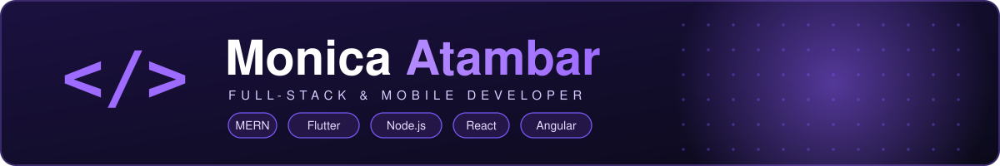
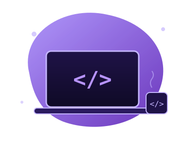
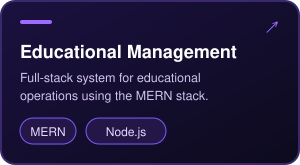
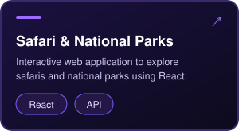
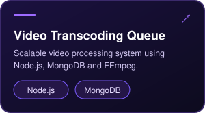

  

<table>
<tr>
<td valign="top" width="62%">

<h2>Hi, I'm Monica Atambar 👋</h2>
<h3>Full-Stack Developer | Flutter Developer | Software Engineer</h3>

I'm a software developer from India passionate about building scalable web applications, intuitive mobile experiences, and practical software solutions.

<ul>
  <li>🔭 Currently working on improving my full-stack and mobile development skills</li>
  <li>🌱 Interested in <b>MERN Stack, Node.js, Flutter & Software Architecture</b></li>
  <li>☁️ Exploring <b>DevOps, Cloud Technologies and System Design</b></li>
  <li>🤝 Open to collaborating on interesting development projects</li>
  <li>💬 Ask me about <b>JavaScript, React, Node.js, Flutter and MongoDB</b></li>
  <li>📫 Reach me at: <a href="mailto:monica123atambar@gmail.com">monica123atambar@gmail.com</a></li>
  <li>🌐 Portfolio: <a href="https://monica-portfolio-36ce7.web.app/">monica-portfolio-36ce7.web.app</a></li>
</ul>

</td>
<td valign="middle" align="center" width="38%">
  
</td>
</tr>
</table>

## 🛠️ Tech Stack & Tools

<table>
<tr>
<td width="33%" valign="top">
<b>&lt;/&gt; Languages</b>  

</td>
<td width="34%" valign="top">
<b>🖥️ Frontend</b>  

</td>
<td width="33%" valign="top">
<b>🗄️ Backend</b>  

</td>
</tr>
<tr>
<td valign="top">
<b>📱 Mobile</b>  

</td>
<td valign="top">
<b>🛢️ Databases</b>  

</td>
<td valign="top">
<b>🔧 Tools & Platforms</b>  

</td>
</tr>
</table>

## 🚀 Featured Projects

  
  
  
  

## 📊 GitHub Statistics

  
  
  

## 🔗 Connect With Me

  
  
  
  

<i>Building, learning, experimenting, and growing one project at a time. 🚀</i>

